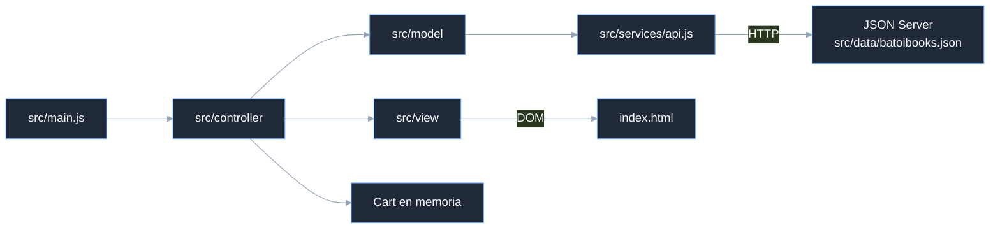

# 📝 Batoibooks

    


BatoiBooks es una aplicación para consultar y gestionar libros de texto y apuntes de segunda mano. Permite añadir, editar y eliminar libros, además de añadirlos a un carrito de compra. Los cambios en los libros se guardan mediante una API HTTP. Está desarrollada con JavaScript y Vite, y cuenta con pruebas automatizadas con Vitest.

## ⚙️ Tecnologías

- 🧪 **Pruebas**: Vitest, jsdom, MSW
- 💾 **Persistencia**: JSON Server
- 🐳 **Infraestructura**: Docker, GitHub Actions
- 🔧 **Herramientas**: Vite, Node.js

## ✨ Características

- 🚀 Desarrollo rápido con Vite y servidor en vivo
- 🧪 Pruebas unitarias automatizadas con Vitest
- 🐳 Contenedorizado con Docker para entornos consistentes
- 🔌 Servicios HTTP centralizados en `src/services/api.js`
- 📚 Colecciones de libros, usuarios y módulos persistentes
- 🔧 Filtrado y consulta de libros por usuario, módulo y estado
- 🖥️ Listado de libros y desplegable de módulos generados en el DOM
- ➕ Formulario compartido para añadir y editar libros; botones en cada tarjeta para comprar, editar o eliminar
- 🛒 Carrito en memoria que guarda una copia del libro y avisa si ya está añadido
- 💬 Confirmación antes de eliminar y mensajes de resultado de las acciones
- ⚙️ Flujo de trabajo CI/CD automatizado con GitHub Actions

<!-- readme-gen:architecture:start -->

## 🏗️ Arquitectura



| Componente | Detalle |
| ---------- | ------- |
| Entrada | `src/main.js` crea la página a partir de la plantilla de `index.html` e inicia el controlador. |
| Controlador | `src/controller/` carga los datos y coordina el alta, la edición, el carrito y el borrado. |
| Vista | `src/view/` renderiza libros, opciones y mensajes; recoge el formulario y escucha las acciones de cada tarjeta. |
| Modelo y API | `src/model/` consulta `src/services/api.js`, que se comunica con JSON Server. |
| Carrito | `src/model/cart.class.js` guarda copias de libros en memoria durante la sesión. |
| Pruebas | Vitest comprueba modelo, carrito, vista y controlador; jsdom simula el DOM y MSW la API. |

<!-- readme-gen:architecture:end -->

## 🗂️ Estructura del proyecto

```txt
batoibooks/
├── .github/                 # Configuración de GitHub
│   └── workflows/           # Flujos de CI/CD
│       └── ci.yml           # Flujo de CI
├── assets/                  # Recursos del proyecto
│   └── banner.svg           # Banner del proyecto
├── notes/                   # Apuntes de las prácticas
│   ├── 1-introduccion.md
│   ├── 2-arrays.md
│   ├── 3-clases.md
│   ├── 4-ajax.md
│   ├── 5-dom.md
│   ├── 5.1-test-dom.md
│   ├── 6-eventos.md
│   └── assets/
│       ├── errorRed.png
│       ├── eventos.png
│       ├── imagen.png
│       ├── mostrarLibros.png
│       ├── resultado-ajax.png
│       └── resultado-clases.png
├── public/                  # Recursos públicos
│   ├── favicon.svg
│   ├── icons.svg
│   └── logoBatoi.png
├── src/                     # Código fuente
│   ├── controller/          # Carga de datos y acciones de la interfaz
│   │   └── controller.class.js
│   ├── data/                # Datos
│   │   ├── batoibooks.json
│   │   └── datos.js          # Datos heredados de prácticas anteriores
│   ├── model/               # Clases del dominio
│   │   ├── book.class.js
│   │   ├── books.class.js
│   │   ├── cart.class.js
│   │   ├── module.class.js
│   │   ├── modules.class.js
│   │   ├── user.class.js
│   │   └── users.class.js
│   ├── services/            # Comunicación con la API
│   │   └── api.js
│   ├── style/               # Estilos
│   │   └── styles.css
│   ├── view/                # Renderizado, formulario y eventos del DOM
│   │   └── view.class.js
│   ├── functions.js         # Funciones heredadas de prácticas anteriores
│   └── main.js              # Punto de entrada principal
├── test/                    # Pruebas
│   ├── cart.test.js         # Copias, duplicados y borrado del carrito
│   ├── contrato.test.js     # Pruebas de contrato heredadas
│   ├── controller.test.js   # Pruebas de carga, alta, edición, carrito y borrado
│   ├── functions.test.js    # Pruebas de funciones heredadas
│   ├── main.test.js         # Prueba inicial heredada
│   ├── model.test.js        # Pruebas de las clases del modelo
│   ├── persistence.test.js  # Pruebas de API y persistencia
│   └── view.test.js         # Pruebas de renderizado, formularios y botones
├── .gitignore               # Archivos ignorados por Git
├── docker-compose.yml       # Configuración de Docker Compose
├── index.html               # HTML principal
├── package-lock.json        # Versiones bloqueadas de dependencias
├── package.json             # Configuración del proyecto
└── README.md                # Documentación del proyecto
```

Los enunciados de las prácticas DOM están en [5-dom.md](notes/5-dom.md), [5.1-test-dom.md](notes/5.1-test-dom.md) y [6-eventos.md](notes/6-eventos.md).

## 📦 Instalación

Puedes arrancar la aplicación con Docker Compose o con Node.js instalado en tu equipo.

### Clonar el repositorio

```bash
git clone https://github.com/DavidTorro/BatoiBooks.git
cd BatoiBooks
```

### Arrancar el proyecto

```bash
docker compose up -d
```

Al arrancar los contenedores, se instalarán las dependencias, se iniciará la API en `http://localhost:3000` y se ejecutará el proyecto en `http://localhost:5173`.

Para usar otra API, crea un fichero `.env` a partir de `.env.example` y define `VITE_API_URL` con su URL.

### Desarrollo local sin Docker

Instala las dependencias y abre dos terminales:

```bash
npm install
npm run api
```

En la segunda terminal, inicia Vite:

```bash
npm run dev
```

La aplicación estará disponible en `http://localhost:5173` y la API en `http://localhost:3000`.

### Parar el proyecto

```bash
docker compose down
```

## 🧪 Pruebas

Este proyecto incluye pruebas con Vitest.

### Ejecutar todos los tests

```bash
docker compose exec batoibooks npm test -- --run
```

También puedes ejecutar los scripts directamente con `npm` si tienes Node.js instalado y las dependencias instaladas:

```bash
npm test -- --run
```

Las pruebas de persistencia y del controlador usan MSW para simular la API; las de la vista y el controlador usan jsdom para simular el navegador. No es necesario arrancar `json-server` para ejecutarlas.

## 👤 Autor

Hecho por **David Torró**

---

Generado con [readme-gen](https://readme-gen.davidtorro.com).
