# 📝 Batoibooks

    


Batoibooks es una aplicación para consultar libros de texto y apuntes relacionados con módulos educativos y usuarios. Carga y persiste los datos mediante una API HTTP, mostrando los resultados por consola. Incluye pruebas unitarias con Vitest y se ejecuta mediante Vite para desarrollo.

## ⚙️ Tecnologías

- 🧪 **Pruebas**: Vitest, MSW
- 💾 **Persistencia**: JSON Server
- 🐳 **Infraestructura**: Docker, GitHub Actions
- 🔧 **Herramientas**: Vite, Node.js

## ✨ Características

- 🚀 Desarrollo rápido con Vite y servidor en vivo
- 🧪 Pruebas unitarias automatizadas con Vitest
- 🐳 Contenedorizado con Docker para entornos consistentes
- 🔌 Servicios HTTP centralizados en `src/services/api.js`
- 📚 Colecciones de libros, usuarios y módulos persistentes
- 🔧 Filtrado y consulta de libros por usuario, módulo y estado
- ⚙️ Flujo de trabajo CI/CD automatizado con GitHub Actions

<!-- readme-gen:architecture:start -->

## 🏗️ Arquitectura

```mermaid
%%{init: {
    "theme": "base",
    "flowchart": { "curve": "basis", "nodeSpacing": 60, "rankSpacing": 90 },
    "themeVariables": {
        "primaryColor": "#1f2937",
        "primaryTextColor": "#f9fafb",
        "primaryBorderColor": "#60a5fa",
        "lineColor": "#94a3b8",
        "tertiaryColor": "#0f172a"
    }
}}%%

flowchart LR
    subgraph SG0["🌐 Aplicación"]
        direction LR
        app["🚀 Punto de entrada<br/>src/main.js"]
    end

    subgraph SG1["⚙️ Lógica"]
        direction LR
        logic["🔧 Clases del dominio<br/>src/model"]
    end

    subgraph SG2["🔌 Persistencia"]
        direction LR
        data["🔌 Servicios HTTP<br/>src/services/api.js"]
        database["💾 JSON Server<br/>batoibooks.json"]
    end

    app -- "carga" --> logic
    logic -- "consulta" --> data
    data -- "HTTP" --> database

    classDef g0 fill:#0f172a,stroke:#38bdf8,color:#f8fafc,stroke-width:2px;
    class app g0;

    classDef g1 fill:#111827,stroke:#c084fc,color:#f8fafc,stroke-width:2px;
    class logic g1;

    classDef g2 fill:#08111f,stroke:#34d399,color:#f8fafc,stroke-width:2px;
    class data g2;

    style SG0 fill:#0b1220,stroke:#38bdf8,stroke-width:1.5px,stroke-dasharray: 4 4,color:#e2e8f0
    style SG1 fill:#0b1220,stroke:#c084fc,stroke-width:1.5px,stroke-dasharray: 4 4,color:#e2e8f0
    style SG2 fill:#0b1220,stroke:#34d399,stroke-width:1.5px,stroke-dasharray: 4 4,color:#e2e8f0
```



| Componente | Tecnología | Detalle                                     |
| ---------- | ---------- | ------------------------------------------- |
| Aplicación | Vite       | Punto de entrada principal en `src/main.js` |
| Lógica     | JavaScript | Clases principales en `src/model/`          |
| Datos      | JSON Server | API local servida desde `src/data/batoibooks.json` |
| Pruebas    | Vitest + MSW | Tests automatizados y simulación de la API |

<!-- readme-gen:architecture:end -->

## 🗂️ Estructura del proyecto

```txt
batoibooks/
├── .github/                 # Configuración de GitHub
│   └── workflows/           # Flujos de CI/CD
│       └── ci.yml           # Flujo de CI
├── assets/                  # Recursos del proyecto
│   └── banner.svg           # Banner del proyecto
├── notes/                   # Enunciado del proyecto
│   ├── 1-introduccion.md
│   ├── 2-arrays.md
│   ├── 3-clases.md
│   ├── 4-ajax.md
│   └── assets/
│       ├── resultado-ajax.png
│       └── resultado-clases.png
├── public/                  # Recursos públicos
│   ├── favicon.svg
│   ├── icons.svg
│   └── logoBatoi.png
├── src/                     # Código fuente
│   ├── data/                # Datos
│   │   └── batoibooks.json
│   │   └── datos.js          # Datos heredados de prácticas anteriores
│   ├── model/               # Clases del dominio
│   │   ├── book.class.js
│   │   ├── books.class.js
│   │   ├── module.class.js
│   │   ├── modules.class.js
│   │   ├── user.class.js
│   │   └── users.class.js
│   ├── services/            # Comunicación con la API
│   │   └── api.js
│   ├── style/               # Estilos
│   │   └── styles.css
│   ├── functions.js         # Funciones heredadas de prácticas anteriores
│   └── main.js              # Punto de entrada principal
├── test/                    # Pruebas
│   ├── contrato.test.js     # Pruebas de contrato heredadas
│   ├── functions.test.js    # Pruebas de funciones heredadas
│   ├── main.test.js         # Prueba inicial heredada
│   ├── model.test.js        # Pruebas de las clases del modelo
│   └── persistence.test.js  # Pruebas de API y persistencia
├── .gitignore               # Archivos ignorados por Git
├── docker-compose.yml       # Configuración de Docker Compose
├── index.html               # HTML principal
├── package-lock.json        # Versiones bloqueadas de dependencias
├── package.json             # Configuración del proyecto
└── README.md                # Documentación del proyecto
```

## 📦 Instalación

Necesitaremos tener Docker con Docker Compose instalado en nuestro sistema.

### Clonar el repositorio

```bash
git clone https://github.com/DavidTorro/BatoiBooks.git
cd BatoiBooks
```

### Arrancar el proyecto

```bash
docker compose up -d
```

Al arrancar los contenedores, se instalarán las dependencias, se iniciará la API en `http://localhost:3000` y se ejecutará el proyecto en `http://localhost:5173`.

Para usar otra API, crea un fichero `.env` a partir de `.env.example` y define `VITE_API_URL` con su URL.

### Desarrollo local sin Docker

Instala las dependencias y abre dos terminales:

```bash
npm install
npm run api
```

En la segunda terminal, inicia Vite:

```bash
npm run dev
```

La aplicación estará disponible en `http://localhost:5173` y la API en `http://localhost:3000`.

### Parar el proyecto

```bash
docker compose down
```

## 🧪 Pruebas

Este proyecto incluye pruebas con Vitest.

### Ejecutar todos los tests

```bash
docker compose exec batoibooks npm test -- --run
```

También puedes ejecutar los scripts directamente con `npm` si tienes Node.js instalado y las dependencias instaladas:

```bash
npm test -- --run
```

Las pruebas de persistencia usan MSW para simular la API, por lo que no necesitan que `json-server` esté arrancado.

## 👤 Autor

Hecho por **David Torró**

---

Generado con [readme-gen](https://readme-gen.davidtorro.com).
