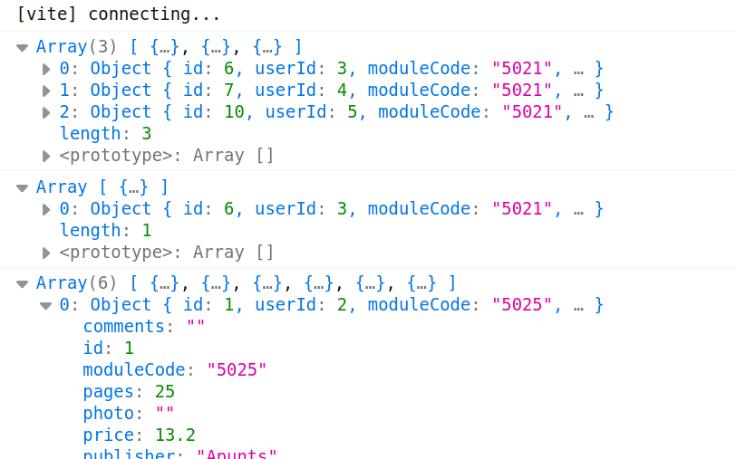

# 4. Persistencia

Continuando con nuestra aplicación para vender libros de texto y apuntes vamos a conseguir que nuestros datos persistan guardándolos en una base de datos y usando una API para obtenerlos y modificarlos. Por tanto ahora los datos ya NO estarán en el fichero [`datos.js`](https://aules.edu.gva.es/fp/mod/resource/view.php?id=10486193) (lo borraremos). Este práctica la haremos en la rama '**4-ajax**'.

Como aún no tenemos nuestra API de Batoibooks hecha en DWES vamos a utilizar la API que proporciona `json-server`, que trabajará con los datos almacenados en el fichero [`batoibooks.json`](https://aules.edu.gva.es/fp/mod/resource/view.php?id=10486211) (recordad que esto es del _backend_ y no tiene nada que ver con nuestra aplicación en el _front_ por lo que ni debería estar en nuestro repositorio).

Para organizar el código crearemos en el directorio `/src/services` un fichero llamado `api.js` con los métodos necesarios para interactuar con la API, o bien podemos crear un fichero para cada tabla (`books.api.js, users.api.js `y `modules.api.js`). Los métodos necesarios serán:

- `getDBUsers`, `getDBModules`, `getDBBooks`: devuelve todos los registros de esa tabla
- `getDBUser, getDBBook`: devuelve el registro cuya _id_ coincide con la pasada como parámetro
- `addDBBook, addDBUser`: recibe un nuevo objeto que añadirá a la tabla
- `removeDBBook, removeDBUser`: recibe la _id_ de un nuevo objeto y lo borrará de la tabla
- `changeDBBook, changeDBUser`: recibe un objeto que ya existe en la tabla y lo modifica, usando el método PUT
- `changeDBUserPassword`: recibe la id de un usuario y sunueva contraseña y lo modifica

Ahora deberemos modificar nuestras clases para que hagan uso de la API que hemos creado, en concreto:

- los métodos `populate` no recibirán nada como parámetro sino que obtendrán los datos de la base de datos
- los métodos `addXxxx, changeXxxx`  y `removeXxxx` modificarán los datos en la BBDD y sólo cuando eso se haya producido los cambiarán en el array `data`
- además añadiremos un nuevo método `changeUserPassword` en `users.class.js` para cambiar la contraseña
- por último eliminaremos el método `incrementPriceOfbooks` que no vamos a usar
- y ya podemos eliminar los métodos/funciones y variables encargados de obtener la _id_ al añadir un nuevo elemento porque de ello se encargará la BBDD

**REFLEXIÓN**: ¿Qué deberíamos hacer con el resto de métodos (`getBookById`, `booksFrom...`, etc)? En principio deberíamos hacer peticiones a la API para obtener esos datos y así asegurarnos que tenemos los últimos datos ya que si otro usuario hace cambios en la BBDD nosotros no nos enteraremos porque sólo leemos los datos al carga la página. Pero por ahora vamos a suponer que sólo nosotros usamos esta aplicación y no habrá más cambios que los que hagamos nosotros, por lo que nuestras clases estarán cargadas con los datos buenos.

En el `main.js` lo que haremos es lo mismo que en la práctica anterior, excepto que ya no carga los datos del fichero ni se los pasa a los métodos `populate`.

El resultado debe ser igual al de la práctica anterior:



**MUY IMPORTANTE**: pasa los tests para asegurarte aprobar este ejercicio. Para pasarlos deberás instalar la librería msw como dependencia de producción

```
npm install --save-dev msw
```
