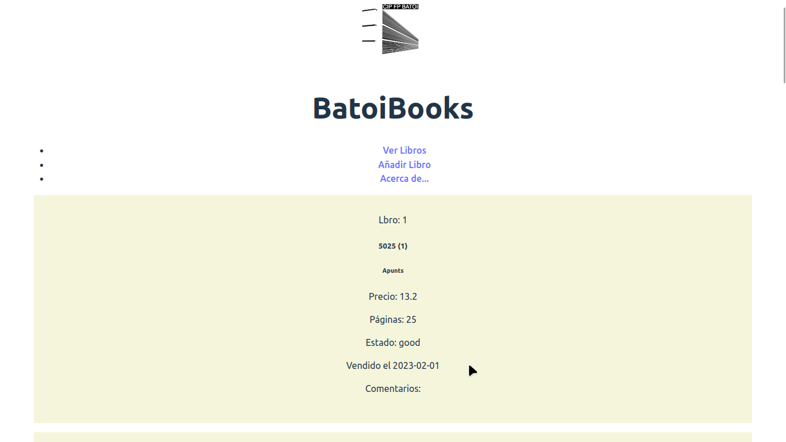
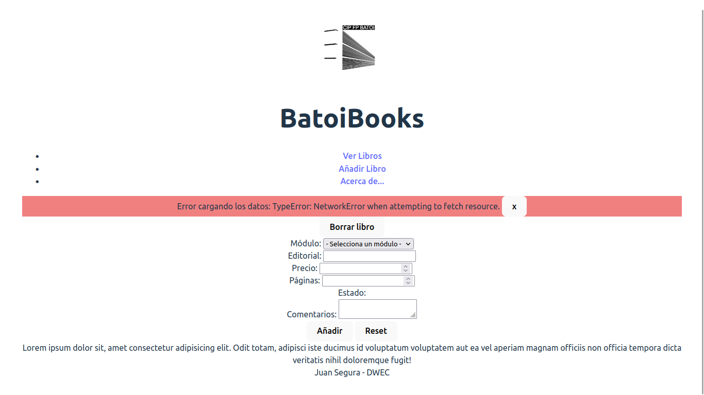
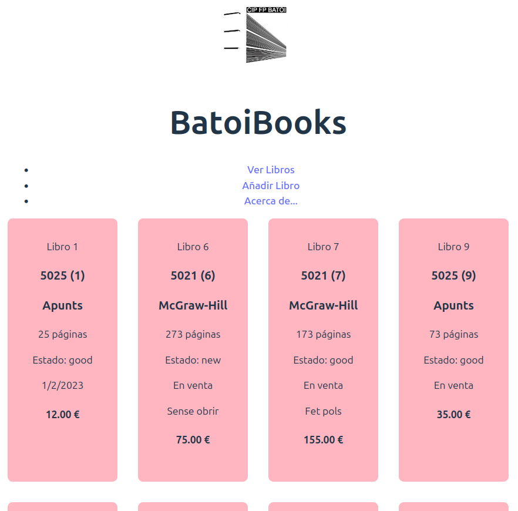

# 5. DOM (sin eventos)

Ahora vamos a empezar a hacer la parte visual de nuestra aplicación. La haremos en la rama **5-dom**.

La estructura visual de nuestra aplicación será:

- Un encabezado con el logo de Batoi y el título «BatoiBooks».
- Un menú con las páginas de la aplicación. De momento tendrá 3 enlaces: «Ver libros», «Añadir libro» y «Acerca de».
- Un div llamado `messages` donde mostraremos mensajes al usuario.
- El div principal donde mostraremos la información. Dentro del mismo tendremos:
  - `<div id="list">`: donde mostraremos la lista de libros.
  - `<div id="remove">`: con un `label`, un `input` donde escribir la id de un libro y un `button` para borrarlo.
  - `<div id="form">`: contendrá un formulario para añadir un libro.
  - `<div id="about">`: contendrá [Lorem ipsum](https://aules.edu.gva.es/fp/mod/url/view.php?id=10486174).
- Un pie de página con vuestro nombre.

La estructura del menú será:

```html
<nav>
  <ul>
    <li><a href="#list">Ver Libros</a></li>
    <li><a href="#form">Añadir Libro</a></li>
    <li><a href="#about">Acerca de...</a></li>
  </ul>
</nav>
```

En el formulario habrá un `<div>` para cada campo de un libro (excepto para la id) y botones de «Guardar» y «Reset». El módulo de los libros será un `select` y el estado serán botones de radio. Los campos deberán tener los atributos de validación que consideréis adecuados (`required`, etc.). Cada campo tendrá como `id` y `name` el nombre de dicho campo en la base de datos.

## main.js

En el `main.js` renderizaremos todo el HTML indicado antes.

Tendrá código para instanciar el controlador cuando se haya cargado la página e inicializarlo:

```js
document.addEventListener('DOMContentLoaded', () => {
  const myController = new Controller()
  myController.init()
})
```

No queremos inicializarlo hasta que la página se haya cargado porque, si intentáramos renderizar un libro dentro del div `list` antes de que se haya pintado, no se vería nada.

Para asegurarnos de que la página está cargada escuchamos el evento `DOMContentLoaded`. También podríamos escuchar el evento `load` de `window` (`window.addEventListener('load', ...)`, `window.onload = ...`).

## Modelo

Ya lo tenemos hecho. Son nuestras clases `Users`, `Modules` y `Books`.

## Vista

Aquí tendremos métodos para todo lo que haya que renderizar en la página, es decir:

- Completar el `select` de módulos.
- Renderizar un libro.
- Eliminar un libro.
- Mostrar un mensaje al usuario.
- Obtener los datos del formulario de añadir libro: al llamarlo devuelve un objeto con el contenido del formulario.
- ...

Las propiedades que tendremos en la clase `View` son, al menos:

- `booksList`: el div donde se mostrarán los libros.
- `about`: el div del [Lorem ipsum](https://aules.edu.gva.es/fp/mod/url/view.php?id=10486174).
- `form`: el div que contiene el formulario de añadir libros.
- `bookForm`: el formulario de añadir libros.
- `moduleSelect`: el `select` del formulario para indicar el módulo.
- `messages`: el div para mostrar mensajes.

Para renderizar un libro crearemos un nuevo div (con la clase `card`) dentro del div de mostrar los libros, cuyo contenido será:

```html
<div class="card-img">
  
</div>
<div class="card-body">
  <h3>cliteral del módulo (id del libro)</h3>
  <h4>Editorial</h4>
  <p>25 páginas</p>
  <p>Estado: good</p>
  <p>En venta // Vendido el 21/12/2023</p>
  <p>Aquí van los comentarios del libro</p>
  <h4>12 €</h4>
</div>
```

Para mostrar un mensaje al usuario haremos un método que recibirá como parámetros un tipo (`error`, `info`) y un mensaje y creará un div dentro de `#messages` como el siguiente:

```html
<div class="tipoRecibido alert alert-tipoRecibido alert-dismissible" role="alert">
  mensajeRecibido
  <button type="button" class="btn-close" data-bs-dismiss="alert" aria-label="Close" onclick="this.parentElement.remove()">x</button>
</div>
```

Si el mensaje **no** es de tipo `error`, se cerrará automáticamente al cabo de 3 segundos, si no lo cierra antes el usuario.

## Controlador

Al inicializarse:

- Cargará los datos en el modelo.
- Cuando tenga los módulos llamará a la vista para que renderice las opciones del formulario con los módulos disponibles.
- Cuando tenga los libros llamará a la vista para que los renderice.

Y tendrá 2 métodos para gestionar la interacción que el usuario hace con la vista (para borrar un libro o añadir uno):

- `handleSubmitBook()`: recibe el nuevo producto del formulario y se encarga de procesarlo.
- `handleRemoveBook()`: deberá procesar el libro a borrar a partir de la id que recibe.

Para probar estos métodos podemos llamarlos desde el `main.js`. En la próxima práctica pondremos escuchadores para que se llamen automáticamente cuando el usuario pulse los botones.

Si sucede cualquier error mostraremos al usuario un mensaje de tipo `error` con el texto del mismo. También mostraremos mensajes informativos que serán de tipo `info` (como «Libro añadido», «Libro eliminado», ...).

En nuestra hoja de estilos podríamos darle algún estilo a estos div para resaltarlos (como en las imágenes que siguen), así como a las `card` o a alguna otra cosa.

## Test

Están en el [punto 5.1](./5.1-test-dom.md).

## Resultado

Si los datos se cargan correctamente veremos en la página:



Si hay algún problema con el servidor veremos algo como esto:



**NOTA**: podríamos mejorar el aspecto en el CSS para que muestre varias tarjetas por fila y así ver mejor los libros:


