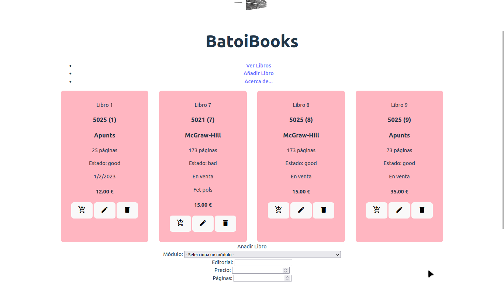

# 6. Eventos

Ahora es el momento de darle a aplicación interactividad para responder a los eventos del usuario. Lo haremos usando una nueva rama de git llamada "6-eventos".

Además aprovecharemos para introducir 3 nuevas mejoras en nuestra aplicación:

- incluiremos iconos para mejorar su aspecto y usabilidad
- modificaremos el formulario para que nos permita editar libros además de añadirlos
- implementaremos un carro de la compra



## Mejoras en la aplicación

### Usar iconos

Vamos a usar los [iconos de Material Design](https://google.github.io/material-design-icons/) de Google. La forma más sencilla es enlazar la librería completa añadiendo al *head* de nuestro *index.html* la línea:

```html
<link href="https://fonts.googleapis.com/icon?family=Material+Icons" rel="stylesheet">
```

Una vez hecho, donde queramos añadir un icono sólo es necesario añadir una etiqueta `<span>` con la clase **material-icons** que contenga el nombre del icono. Por ejemplo para añadir el icono de una cara (el icono se llama *face*) pondremos:

```html
<span class="material-icons">face</span>
```

Sin embargo esto no es lo más recomendable ya que estamos cargando todos los iconos (unas decenas de KB) cuando sólo necesitaremos unos pocos. La alternativa sería descargar sólo los que queramos usar e importarlos como hicimos con el logo de Batoi (podemos descargarlos en formato SVG para que se vean correctamente sea cual sea su tamaño a una carpeta *assets* que crearíamos dentro de *src*) pero por comodidad lo haremos como hemos visto antes.

En la página de Material Design podemos consultar las diferentes opciones que tenemos para descargar los iconos o cambiar su estilo o tamaño.

Nosotros los incluiremos dentro de botones, por lo que su HTML será:

```html
<button>
    <span class="material-icons">face</span>
</button>
```

Vamos a incluir 3 botones en la parte inferior de cada libro para:

- icono *add_shopping_cart*: para añadir el libro al carrito de la compra
- icono *edit*: servirá para editar el libro en el formulario que tenemos
- icono *delete*: para eliminar el libro

Por tanto ya podemos **eliminar el DIV** del botón para borrar libros que tenemos antes del formulario.

### Modificar el formulario

Para utilizar este formulario tanto para añadir como para editar libros haremos unos cambios en el HTML del formulario dentro del `main.js`:

- vamos a ponerle un título al formulario, que será 'Añadir libro'
- vamos a crear al principio del formulario otro DIV con un INPUT de texto para poner la id del libro, pero este DIV estará oculto

### Carrito de la compra

Vamos a gestionar un carro de compra para lo que crearemos una nueva clase que se llamará `Cart` similar a la de libros: sólo tendrá la propiedad `data` que se inicializará a un array vacío en el constructor, y los métodos:

- `populate`: por ahora no hará nada
- `getBookById`: recibe una *id* y devuelve el libro del carrito con esa *id* o {} si no existe
- `addItem`: recibe un objeto de tipo `Book` del que hace una copia y lo añade al `data` (es decir, no añade el libro recibido sino una copia del mismo). Si ya estuviera lanza un error
- `removeItem`: recibe una *id* y borra del carrito el libro con esa *id*. Si no estuviera lanza un error
- `toString`: muestra información de los libros del carrito

Modificaremos el controlador para que tenga también un carrito y al inicializarlo llamará también al `populate` del carrito.

**REFLEXIÓN**: ¿por qué el método `addItem` añade una copia del libro y no el propio libro?

## Acciones del usuario

Las acciones del usuario a las que debe responder nuestra aplicación son:

- envío del formulario para añadir un nuevo libro
- click sobre el icono de añadir el libro al carrito
- click sobre el icono de modificar el libro
- click sobre el icono de eliminar el libro

Para enterarnos de estas acciones deberemos ponerles un escuchador pero ¿quién debe hacerlo?:

- lo lógico parece ser que lo haga la vista pero la vista no sabe qué hay que hacer cuando se produce el evento porque eso es responsabilidad del controlador
- pero el controlador, ¿cómo puede acceder a esos botones que ha pintado la vista?

Para decidir cómo hacerlo debes leer y entender la comunicación dentro del patrón MVC que tienes en la teoría.

Veamos qué debe pasar en cada uno de esos eventos.

### Envío del formulario

Al producirse el evento se deben coger los datos del formulario y enviarlos al método del controlador *handleSubmitProductForm* para que añada el nuevo libro al modelo y luego lo pinte la vista. Una vez hecho se borra el formulario.

**NOTA**: al añadir un nuevo libro hay que indicar el userId de quien está dando ese libro de alta pero en el formulario no tenemos ese dato. Es porque se supone que ya nos hemos autentificado antes y por tanto tenemos un userId, el nuestro. Vamos a suponer que nosotros somos el usuario 2.

### Icono de Añadir al carrito

Al pulsar sobre el icono se añadirá el libro al carrito y se mostrará un mensaje diciendo que se ha añadido. Si el libro ya estuviera en el carrito se mostrará un mensaje de error indicándolo.

### Icono de Eliminar libro

Se le pedirá confirmación al usuario mostrando la id y el módulo del libro y a continuación se llamará al método *handleRemoveBook* que elimina el libro del modelo y luego se elimina de la vista y se muestra un mensaje al usuario.

### Icono de Editar libro

Cuando el usuario pulse el botón de editar un libro lo que debe pasar es:

- cambia el título del formulario a 'Editar libro'
- se muestra el DIV de la id pero con el INPUT deshabilitado
- se completan todos los INPUT del formulario con los datos del libro

¿Quién será el responsable de hacer esos cambios?

Ahora el formulario sirve tanto para añadir como para editar por lo que el manejador de su `submit` en el controlador deberá saber qué quiere hacerse (añadir o editar) y obrar en consecuencia.

Tras modificarse el libro se vacía el formulario y vuelve a quedarse preparado para añadir un nuevo libro. Lo mismo pasará al pulsar el botón de 'Reset'.

Para modificar un libro en el modelo tenemos ya un método en la clase `Books` y para renderizarlo necesitaremos hacer uno en la *vista*.
